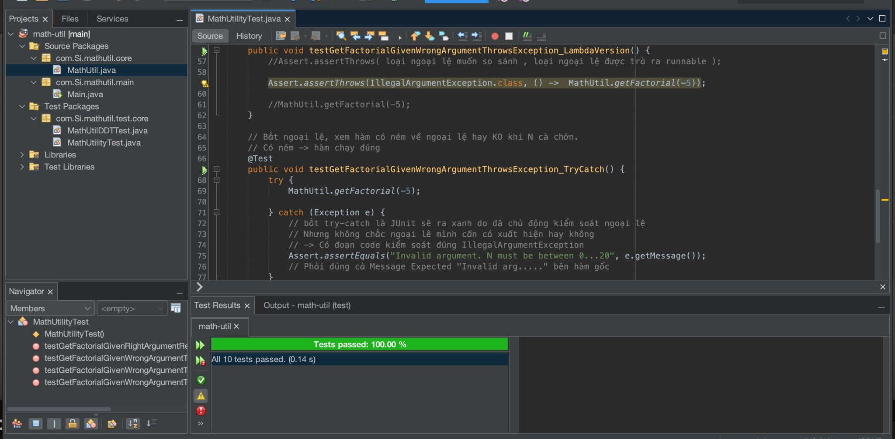

[](https://github.com/MinhThuc1/math-util/actions/workflows/ci-junit.yml)

# Welcome to Math-Util Repository
### You will find in this Repo the following stuff:
* The Math-Util library that offers multiple math functions (a Java-based source code)
* Unit Testing source code with JUnit framework
* GitHub Actions to demonstrate the Continuous Integration (CI) technique
* Regression Test
* ... Coming Soon


### Screenshots


#### © 10/2026 Si

## MathUtil with JUnit 5

Phiên bản sử dụng **Java 21**, **Maven** và **JUnit 5**, kèm cấu hình Continuous Integration bằng GitHub Actions.

- [Xem source code và hướng dẫn tại branch `mathutil-junit5`](https://github.com/MinhThuc1/math-util/tree/mathutil-junit5)

```bash
git clone --branch mathutil-junit5 https://github.com/MinhThuc1/math-util.git
cd math-util
mvn clean test
```

Source code của phiên bản ban đầu được lưu tại [branch `math-util`](https://github.com/MinhThuc1/math-util/tree/math-util).
